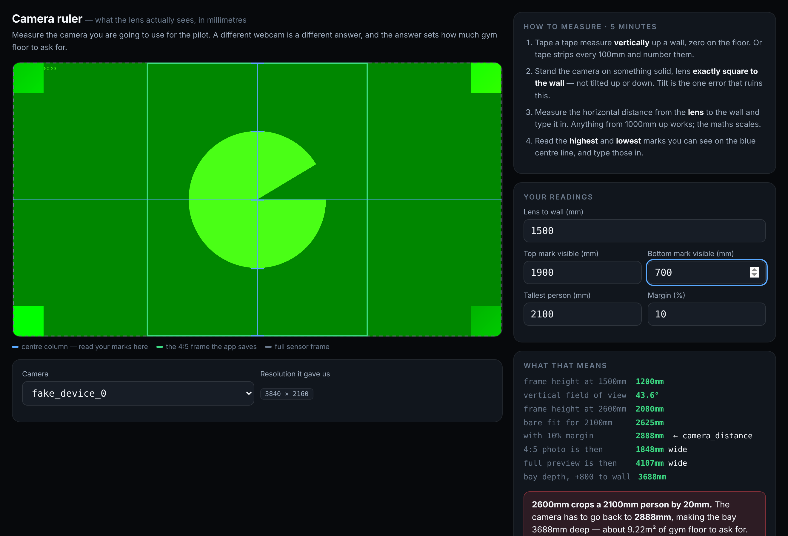

# PODIUM — four hours at Luca's

**A run sheet for two people, three machines and one tape measure**

16 October 2026

---

## What tonight is actually for

Four hours with an AI in the loop realistically gets you through Step 5 of the
brief, not Step 9. So here is the order things matter in, and the first three
are the whole point:

1. **The measured field of view** of the camera you will actually use.
2. **The camera distance** that follows from it, and the **bay depth** that
   follows from that.
3. **A footprint taped on a floor** that you have both stood inside.

All three are inputs to the conversation with Aspire this weekend, and not one
of them can be got from an AI, a spec sheet or a render. Everything after that
is a bonus. If the evening ends with those three written on paper, it paid for
itself.

---

## Before you leave the house

- [ ] **Tape measure, 5m.** The single most important object tonight.
- [ ] Masking or painter's tape — a full roll
- [ ] Laptop and charger
- [ ] Tablet, with this page and `LUCA-BRIEF.pdf` on it
- [ ] **The webcam you intend to use for the pilot**, if you own one
- [ ] A sheet of cardboard, or newspaper and sticky tape, and scissors
- [ ] Phone, for photographs
- [ ] Something to eat. It is four hours.

**Send Luca `LUCA-BRIEF.pdf` now**, and ask him to do one thing before you
arrive: install OpenSCAD from **openscad.org** → Download → Windows installer.
It is a download and a double-click, but it is a few hundred megabytes and you
do not want to spend the first twenty minutes watching a progress bar.

## The three machines

| | |
|---|---|
| **Luca's PC** | OpenSCAD and Gemini Pro. F6 on a full model with three versions, a human figure and two translucent cones is genuinely not a laptop job — this is why the modelling happens here. |
| **Your laptop** | The camera, the measuring tools, the live app, and git. The camera has to be where the tape measure is, which is why the two tracks below are separate. |
| **The tablet** | This run sheet and the brief, propped up where both of you can see it, because both your hands will be busy. |

---

## Hour 1 · 0:00–1:00 — get both tracks moving

### 0:00–0:10 · Together: show him the thing

Ten minutes of using it beats seventeen pages of reading about it.

- [ ] Laptop → **https://jgmeyer13.github.io/skills-copilot-codespaces-vscode/**
- [ ] Luca runs one full session on himself — check in, consent, mirror, thirty
      seconds, review
- [ ] Open the operator console (bottom right, **Operator**) and show him the
      sealed dashboard
- [ ] Then split up. From here the two tracks run at the same time.

### 0:10–0:55 · PC track — Luca

- [ ] OpenSCAD open, Gemini Pro open in a tab, brief section 6 to hand
- [ ] Paste the **Step 1** prompt from brief section 7, with the parameter block
- [ ] F5
- [ ] **Check:** count the 500mm grid squares across the bay box. Five of them.
      If the box is 2.5 units wide instead of 2500, stop and fix the scale now —
      everything after this compounds it.
- [ ] Paste **Step 2**. The person and the floor mark.
- [ ] **Check:** the figure's head sits just under the top of the box — 2100mm
      inside 2400mm. Ankle-high or through the ceiling means the proportions ran
      off a different variable.

### 0:10–0:55 · Camera track — the laptop

Open the camera ruler. It is a page built for exactly this measurement:

**https://jgmeyer13.github.io/skills-copilot-codespaces-vscode/fov.html**



- [ ] Pick **the camera you will use in the pilot** in the dropdown. A different
      webcam is a different answer.
- [ ] Tape the tape measure **vertically** up a wall, zero on the floor
- [ ] Camera on something solid, **square to the wall — not tilted**. Tilt is the
      one error that ruins this.
- [ ] Measure lens-to-wall, type it in. 1500mm is plenty; the maths scales.
- [ ] Read the highest and lowest marks visible **on the blue centre line** and
      type them in
- [ ] **Write the three numbers on paper:** the vertical field of view, the
      camera distance, the bay depth.

### 0:55–1:00 · Together

- [ ] Luca types your measured `fov_vertical` and `camera_distance` into the
      parameter block, replacing 43.3 and 2600
- [ ] Add a comment beside them: which camera, measured tonight, and the date.
      In six weeks nobody will remember which webcam that number came from.

---

## Hour 2 · 1:00–2:00 — the number that sets the floor space

### PC track — Luca

- [ ] Paste **Step 3** — the camera, both view frustums, and the `echo()`
- [ ] Look down the camera axis. The numpad keys 4, 5 and 6 cycle the views.
- [ ] **Check:** is the figure inside the inner cone, with air above the head and
      below the feet?
- [ ] Compare Gemini's echoed frame height against the ruler's number for the
      same distance. They should agree within a few percent.
      **If they disagree, the tape measure wins.**

### Camera track

- [ ] Tape a **2500 × 3500mm** rectangle on Luca's floor. Then add a second line
      at **3900mm** deep.
- [ ] Both of you stand in it. Walk in through the open front. Put a chair where
      the laptop goes and a broom where the light stand goes.
- [ ] Photograph it from the doorway.

That rectangle is what you show the gym owner. *"This much floor, roughly where
that bench is"* is a conversation. *"9.2 square metres"* is a number they will
round up in their head and say no to.

### 1:40–2:00 · Together: the body test

This is the one that settles it, because it uses a real camera and a real body
instead of a spec sheet.

- [ ] Camera at the distance the ruler gave you, aimed at a taped mark
- [ ] The taller of you stands on the mark
- [ ] Look at the **green 4:5 box** on the ruler page. Head and feet inside it,
      with air to spare?
- [ ] Step 200mm left. Then 200mm right. Still inside?
- [ ] **Write the answer down.** Everything about the size of this bay rests on
      it.

---

## Break · 10 minutes

Eat something. You are halfway and the next hour is the fun one.

---

## Hour 3 · 2:10–3:10 — is the light in the shot?

### 2:10–2:35 · Together: the cardboard softbox

Brief section 4.3 says the softbox probably intrudes into the frame, by
somewhere between 20mm and 80mm. That was arithmetic. This costs nothing and
settles it.

- [ ] Cut or tape out a **350 × 1600mm** rectangle — cardboard, newspaper,
      anything flat and the right size
- [ ] One of you holds it upright, face turned toward the mark, **1200mm from
      the mark at 45° off the camera axis**. In practice: about **850mm to the
      side and 850mm toward the camera**.
- [ ] The other watches the ruler page
- [ ] **Is any part of it inside the green 4:5 box?**
- [ ] Photograph the screen, whichever way it goes
- [ ] If it is in shot: slide it back until it is out, and measure the new
      distance and angle. That is a real design input and it came from a piece
      of cardboard.

### 2:35–3:10 · PC track — Luca

- [ ] Paste **Step 4** — the stand, the softbox, the throw cone, and the
      clearance answer in millimetres
- [ ] Compare its clearance number against what you just watched happen with the
      cardboard. If the model says a metre of clearance and the cardboard was in
      shot, the model has the light on the wrong side.

---

## Hour 4 · 3:10–4:00 — versions and the cut list

### PC track — Luca

- [ ] **Step 5** — version 1, the weekend corner
- [ ] **Step 6** — version 2, the pine unit, **and the cut list**

The cut list is the commercially valuable output of the whole evening. It
replaces a guessed R30,000 with a number of metres, a number of lengths and a
price. Nothing else tonight changes a spreadsheet.

### Camera track

- [ ] Take the cut list and price it — look up South African pine batten prices
      and write the per-metre rate down **separately**, so it can be corrected
      without redoing the list
- [ ] Put the evening's numbers in a file on the laptop as you go, not at the end

### 3:45–3:55 · Together

- [ ] **Step 8** — the blunt review. Argue with it. If it says something you both
      know is wrong, say so and make it try again. If it says something that
      stings, write it down.

### 3:55–4:00 · Save everything

- [ ] F6 render, then File → Export → STL, once per `show_version`
- [ ] Three screenshots per version: front, side, and **down the camera axis** —
      that last one is the one everybody will actually look at
- [ ] The `.scad` file, the STLs and the screenshots onto the laptop or into the
      repo

---

## If you fall behind

Finish **hour 1 and hour 2**. That is the measured field of view, the camera
distance, the bay depth and a footprint on the floor. Hours 3 and 4 can happen
on any evening and do not need you both in the same room. Hour 2 does.

## Two things not to do tonight

- **Do not buy anything.** The shopping list waits until after the gym visit.
  All three economic analyses agreed on that, and the one thing that would
  change it — a gym owner saying yes — has not happened yet.
- **Do not design around a corner nobody has measured.** Aspire gets measured
  this weekend. Tonight is the camera and the frame, which are true wherever
  the bay ends up standing.

## Before you leave

- [ ] `.scad` file, STLs and screenshots saved somewhere that is not only
      Luca's desktop
- [ ] The three numbers on paper **and** typed into the repo
- [ ] Photographs: the taped footprint, the body test, the cardboard softbox
- [ ] Anything Luca said that surprised you, written down before you forget it

---

## Three decisions still open

Not tonight's work, but they are going to be asked for, so know where they
stand:

| | |
|---|---|
| **R20 or R40** | Decide **before** the pilot starts. The software records the thresholds the moment you press *Start real pilot* and flags any later change, because sessions at two prices are not the same measurement. R20 is a test price, not a tested one — Evolt charges R250–R920 a scan, InBody R350. |
| **Which camera** | Whichever one you measure tonight is the one that sets `camera_distance`. Swapping it later changes the bay depth, which changes what you asked the gym for. |
| **Phone transfer** | Still unresolved. Sending photographs to a member's phone over a laptop hotspot has never been tested on that laptop, and it may simply not be reliable. It needs an honest answer before the pilot, not a workaround. |

## For Luca — getting everything

The repository is public. No login, no account, nothing to ask for:

```bash
git clone https://github.com/jgmeyer13/skills-copilot-codespaces-vscode.git
cd skills-copilot-codespaces-vscode/pilot
git checkout kelvin-command-centre     # where the current work lives
python3 -m http.server 4400            # then http://localhost:4400
```

Everything referenced in the brief is in that folder: `README.md`,
`DECISIONS.md`, `FIELD-RESEARCH.md`, `RISKS-POPIA.md`, `RUNSHEET.md`, the
source, and the test suite. `node tools/verify.mjs` runs the lot against a fake
camera if you want to see it prove itself.

The camera ruler is `pilot/fov.html`, or live at the URL in hour 1.
