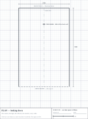
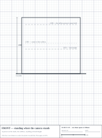
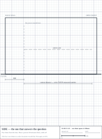
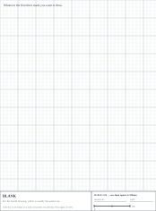

# PODIUM — the paper night

**Four jobs, no screen. Print this, find a pencil.**

16 October 2026

---

The bay has never been drawn. It exists as a parameter block and three
paragraphs of trigonometry, and the first thing that would have seen it as a
shape is OpenSCAD — which is the wrong way round. The mistakes a drawing
catches are obvious on paper in a minute and invisible in code for an evening.

So tonight is the drawing, and three things that have been waiting for someone
to sit down with a pen.

| | | |
|---|---|---|
| **1** | Draw the bay | 40 min · sheets 1–4 |
| **2** | Write the sheet you put in front of the gym owner | 20 min |
| **3** | Do the money by hand | 20 min |
| **4** | Decide the three open things | 10 min |

Job 1 is the one that pays off twice: it is worth doing for its own sake, and
it makes the OpenSCAD go at twice the speed when you get back to it, because
you will already know what you are building.

**Before you start:** print the four sheets and check the scale bar in the
title block measures **40mm** with a ruler. If it does not, your printer has
helpfully resized the page and every number you take off the drawing will be
wrong by the same fraction. Print again with scaling off.

[newpage]

## Job 1 — draw the bay

Three views of the same thing, at **1:25**. One 4mm square is **100mm** of
gym. The bay, the mark and the key heights are already on the sheets, so you
are not starting at a blank page — what you are adding is everything that has
to fit around a person.

**Sheet 1 · PLAN.** Looking straight down. Draw, in this order:

1. The camera, on the centre line, at your measured distance from the mark
2. Two lines from the lens, opening outwards — the edges of what it sees
3. The softbox: 1200 from the mark, 45° to one side, 350 × 1600 in plan
4. The light stand's tripod — about 900 across, and it is on the floor where
   feet go
5. The reflector board on the other side
6. The laptop, the monitor, and **every cable, drawn as a line to a plug**
7. The way a person walks in, as an arrow

Then look at it and ask: **does anything cross the arrow?** That is the
question plan views are for.



[newpage]

## Sheet 2 — front

Standing where the camera stands. The heights that matter are already ruled
across it.

Draw a person on the mark, 2100 tall. Then the softbox beside them, the
monitor, and anything else at head height. Mark where the fabric hangs.

**The question this one answers:** is the monitor in someone's face, and does
the softbox start above the knees of a tall person? The bottom of a 1600 box
centred at 1300 is 500 off the floor — draw it and you will see exactly how
much leg is below the light.



[newpage]

## Sheet 3 — side

**The sheet that answers the question the whole business is waiting on.**

The camera axis is already drawn. Put the lens where your measured camera
distance says, then draw **two lines from the lens** opening up and down at
half your measured field of view each side of the axis.

Then draw the person on the mark, 2100 tall.

- Head and feet between the two lines, with air? **The number is right.**
- Head or feet outside? **Move the lens back until they fit**, and measure
  the new distance off the sheet with a ruler. × 25 = millimetres of gym.

That number is what you ask Aspire for. It is worth doing twice.



[newpage]

## Sheet 4 — blank

The useful drawing is usually the fourth one.

Detail of the light stand foot where someone will kick it. The cable run. How
the fabric actually hangs off a wall. A corner of the frame at full size. The
thing you noticed on sheet 1 and could not fit anywhere.



[newpage]

## Job 2 — the sheet you put on the counter

Twenty minutes, by hand, on one side of A4. Not a pitch deck. A gym owner
reads one page or none.

Hand-drawn is **better** here, not worse: it says you made this for them this
week, and it invites them to take the pen and change it. A printed deck says
you say this to everyone.

Lay it out like this, and write it out properly once you have got it right in
rough:

```
┌──────────────────────────────────────────────┐
│  PODIUM                                      │
│  A photograph your members can compare.      │
│                                              │
│  ┌─────────────┐   ┌─────────────┐           │
│  │   sketch    │   │   sketch    │           │  ← the corner, and a
│  │  the bay    │   │  then/now   │           │     then-and-now pair
│  └─────────────┘   └─────────────┘           │
│                                              │
│  WHAT IT IS      30 seconds. 5 photos.       │
│                  They keep what they want.   │
│                  Nothing leaves the laptop.  │
│                                              │
│  WHAT IT COSTS   ___ m² of your floor        │
│   YOU            ___ for four weeks          │
│                                              │
│  WHAT YOU GET    [leave this blank until     │
│                   after you have asked them  │
│                   what retention is worth]   │
│                                              │
│  THE TRIAL       Four weeks. I run it.       │
│                  You see every number.       │
│                  If members do not come      │
│                  back, I pack it up.         │
└──────────────────────────────────────────────┘
```

**Leave "what you get" blank on purpose.** You fill it in while they are
talking, using their number, not yours. A figure you brought with you is a
guess; a figure they said back to you is an agreement.

### The six questions, on a card in your pocket

1. What does a square metre of your floor earn you?
2. What do you spend on retention now — apps, challenges, InBody, anything?
3. Have you ever paid monthly for something meant to keep members? What, and
   how much?
4. If this kept two members a year who would have left, what is that worth a
   month?
5. Would you rather: members pay me, you pay me monthly and they go free, or
   split it?
6. What would make you say no to this entirely?

Then: *"If the four weeks show people come back, would you pay R1,500 a
month?"* — and **watch the face, not the answer.**

[newpage]

## Job 3 — the money, in your own handwriting

Three analyses did this for you. Do it once yourself and you will be able to
answer an owner without reaching for your phone, which is worth more than the
arithmetic.

Fill in the blanks. Round hard — this is about the shape, not the decimals.

```
WHAT ONE POD COSTS TO BUILD
   Weekend corner build (the shopping list)    R  7,200
   Pilot-grade freestanding unit               R __________  ← guess
   Production pod                              R __________  ← guess

WHAT IT EARNS IN A MONTH, FROM MEMBERS
   sessions a day            __________
   × price per session    R  __________
   = per day              R  __________
   × 26 days              R  __________   (A)

WHAT IT COSTS TO RUN IN A MONTH
   your time: ____ hrs × R____            R __________
   electricity, consumables, breakage     R __________
   the gym's cut, if any                  R __________
   = total                                R __________   (B)

PROFIT A MONTH                 (A) − (B) = R __________   (C)

MONTHS TO PAY BACK   pod cost ÷ (C)      = __________

NOW DO IT AGAIN with the gym paying R1,500/month and members free:
   (A) = 1,500        (B) = __________   (C) = __________
   months to pay back = __________
```

**Then answer these three in writing, in a sentence each:**

- At your real pilot target of 4 sessions a day, which of those two columns
  is a business?
- What price would members have to pay for the first column to work? Would
  you pay it?
- If the answer is the gym fee, what does that change about **who the product
  is for** — and does anything on the screens need to change to match?

The third one is the real question, and nobody has asked it yet.

[newpage]

## Job 4 — three decisions

Each has been open for a week. Each takes a minute once you make yourself sit
with it. Tick one, write one line of why, and it is done.

**1 · Price for the pilot.** One price, four weeks. The software locks your
thresholds when you press *Start real pilot* and flags any later change,
because sessions at two prices are not the same measurement.

```
[ ] R20    [ ] R40    [ ] free, and ask for the gym fee instead

because ______________________________________________________
```

For scale: Evolt charges R250–R920 a scan. InBody R350. DQ Fitness in
Somerset West lists R300, or R899 for four.

**2 · Which camera.** Whichever one you measure is the one that sets the
camera distance, which sets the bay depth, which sets what you ask the gym
for. Changing it later changes all three.

```
[ ] the laptop's built-in    [ ] a webcam I already have    [ ] buy a C920

because ______________________________________________________
```

**3 · Photos to the phone.** Sending over a laptop hotspot has never been
tested, and it may not be reliable in a gym full of phones. The honest options
are to test it properly, or to decide the pilot does not do it.

```
[ ] test the hotspot before the pilot    [ ] pilot without it, say so on screen

because ______________________________________________________
```

---

**When you come back to a screen**, bring: the camera distance off sheet 3,
the pod costs from job 3, and these three ticks. All three go straight into
the OpenSCAD parameter block and the config, and the pilot cannot start
without the last one.

Rest your eyes. The code is not going anywhere — it is committed, pushed, and
passing.
