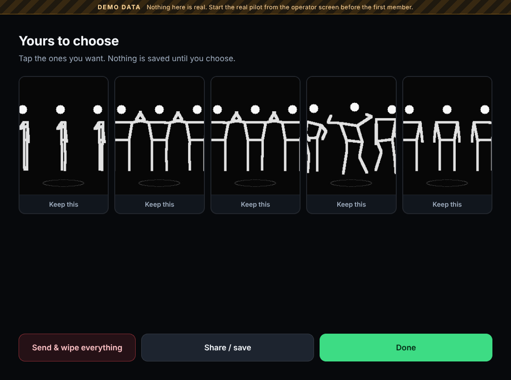
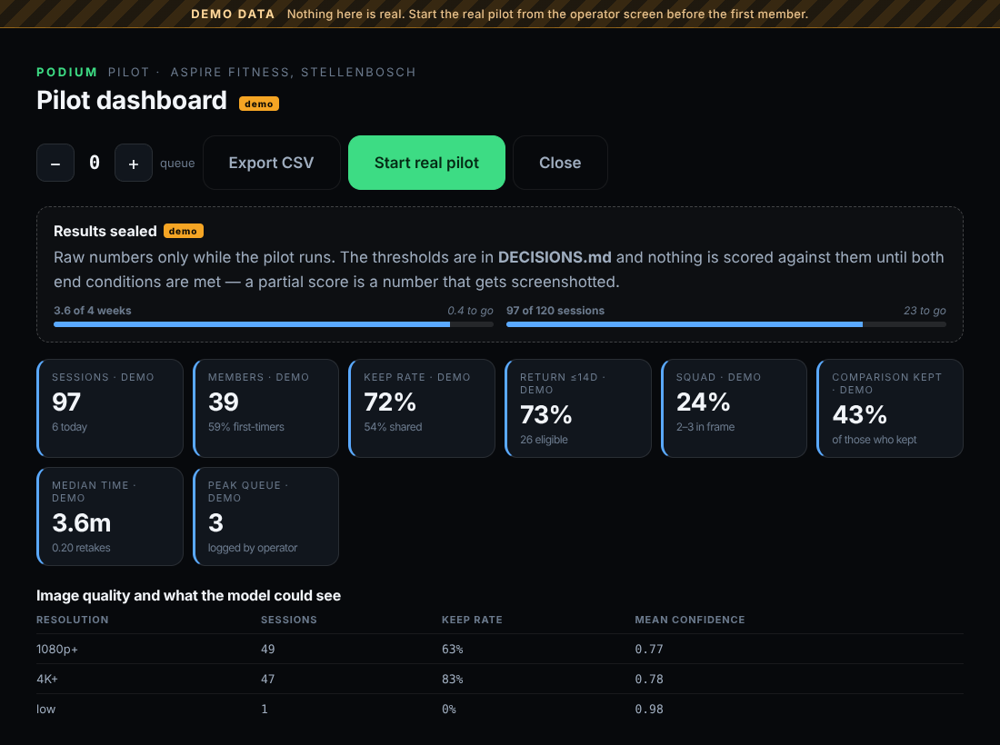

# PODIUM — the brief for Luka

**What it is, where it stands, and the piece that is yours**

16 October 2026 · Stellenbosch

---

Thanks for taking this on. You are getting the part of the project that
everything else is currently waiting on, so this document is long on purpose:
by the end of it you should know as much about PODIUM as anyone does, and
exactly what to build.

Realistically it is an evening's work for the part that matters — steps 0 to 4
in section 7, which is where the camera, the field of view and the light get
settled. Everything after that is the fabrication detail and can follow
whenever. Read section 4 even if you read nothing else; it is the bit I think
we have wrong.

One thing to know up front: **the gym corner has not been measured yet.** That
happens this weekend. So build it parametric, and when the real numbers come
back they are a five-minute edit rather than a redraw. That is the whole
argument for doing it in code.

> ### The short version
>
> - **PODIUM** is a standardised physique-photography bay that lives in a
>   corner of a gym. Thirty seconds, five photographs, and the point is that
>   two visits four weeks apart are *comparable* — same spot, same light,
>   same framing, same pose.
> - **The software is built.** It runs in a browser, does pose detection
>   on-device, aligns a returning member to where they stood last time, and
>   passes a 33-step automated test. It is live and you can open it.
> - **The physical bay does not exist.** There is a shopping list and a set of
>   dimensions, and the dimensions have never been checked against each other
>   by anything other than arithmetic.
> - **Your part: a parametric 3D model in OpenSCAD.** Three versions — the
>   weekend corner build, the pilot-grade freestanding unit, the production
>   pod. With the camera's field of view drawn as a cone, because that one
>   object answers the question the whole business is sitting on.
> - **Why it matters commercially:** the two numbers that decide whether this
>   is a business are *build cost* and *floor area*, and your model is what
>   sets both. The cost estimates in the spreadsheet right now are guesses.
>   Your cut list replaces them with numbers.

---

## 1. What PODIUM actually is

A member walks up to a laptop in the corner of their gym. They tap in a
number, tick three consent boxes, and stand on a taped mark on the floor. A
live mirror on screen tells them one thing at a time — *step back*, *step
left*, *square up* — until a ring around their hips fills and locks. Then
thirty seconds: three named poses with a countdown, plus one candid frame it
takes while they are not posing.

Five photographs come up. They keep the ones they want, send the ones they
want to their phone, and everything else is deleted on the spot. Four weeks
later they come back, stand on the same mark, and the screen shows them then
and now, side by side, aligned.

That is the product. The interesting bit is not the photography.

**The interesting bit is repeatability.** If the light moved 300mm, or the
member stood 200mm further forward, or the camera got nudged and re-aimed,
then the two photographs are not a measurement — they are just two nice
pictures, and the whole proposition collapses into a photo booth. Gyms
already have mirrors and members already have phones. The only thing PODIUM
can sell that they cannot get for free is *the same photograph twice*.

Repeatability is geometry. It lives in floor marks, lens distance, light
position and the absence of a window. Which is why a 3D model is not
decoration here — it is the design.

---

## 2. What already exists, so you do not rebuild it

Open this on your phone or your PC. It is the real app, running from GitHub
Pages, no install:

**https://jgmeyer13.github.io/skills-copilot-codespaces-vscode/**

It will ask for your camera. Everything stays on your device — there is no
server to send anything to.

| Piece | State |
|---|---|
| Check-in | done — two identity modes |
| Consent | done — two languages, editable by a non-programmer |
| The alignment mirror | done |
| The thirty seconds | done — pose detection and best-frame selection |
| Review and keep / send | done — anything not kept dies on the spot |
| Then-and-now comparison | done |
| Operator console | done — four tabs |
| Deletion and forget-me | done, including the end-of-day purge |
| Automated tests | 33 steps, all passing |
| **The physical bay** | **nothing. This is you.** |

### The alignment mirror


MediaPipe Pose runs in the browser and returns 33 body landmarks per frame.
The app compares the live body against the ghost of where this member stood
last visit, on four independent axes — distance, left/right, up/down, and how
square they are to the camera — and converts that into exactly one
instruction, because four corrections at once get none of them done.

Every measurement is normalised by the member's own torso height, so it works
the same for a 1.6m person and a 2m person. The score is multiplicative
rather than a weighted sum, which matters: a weighted sum let a body that was
side-on but perfectly centred score 0.30 and look half-right. It is not.

It never disables the Start button. Alignment is advice, and advice that
locks the door is not advice.

### Honest measurement, which shapes everything



The pilot exists to answer one question: **is this an instrument or a photo
booth?** An instrument is something people want a record from, and a gym pays
for because it keeps members. A photo booth is a novelty people try once.
They need different companies built around them, and they conflict —
comparable frames need one fixed light and fixed poses, posting wants variety
and candids.

So the capture produces both from the same thirty seconds, labels which is
which, and records which ones members actually keep. The thresholds were
written down *before* the first session, and the operator console is
**sealed** while the pilot runs: raw counts only, no verdict, no pass marks.
It unseals itself when both end conditions are met. An earlier version showed
"reads as an instrument" from session one, which is exactly the peeking the
discipline exists to prevent.



The go / no-go numbers, so you know what success looks like:

| Rule | Go | Stop |
|---|---|---|
| First-timers who return within 14 days | ≥ 30% | < 10% |
| Sessions where the member kept at least one photo | ≥ 55% | < 20% |
| Median time inside the bay | ≤ 6 min | — |

### What the software cannot do

It cannot make a room repeatable. It can tell a member they are 80mm too far
left; it cannot stop afternoon sun coming through a window, stop someone
re-aiming a nudged camera by eye, or stop the light stand being moved to get
a bench past it. Those are solved in hardware or not at all.

---

## 3. Why the millimetres decide whether this is a business

Three independent analyses were run on the economics. They disagreed about
almost everything except one conclusion:

> **Members paying R20 a session does not pay for a pod.** The model only
> works if the gym pays a monthly fee.

The numbers, rounded and honest:

| | |
|---|---|
| Break-even at R20 a session | about **5.4 paid sessions a day** |
| The pilot's own target | **4 a day** — below break-even |
| Payback on a R65,000 pod at 4/day | about **56 months**. It will not last that long |
| Payback if a gym pays R1,500/month | about **21 months** on the production pod, **10 months** on a pilot-grade one |
| Kill number | under **30%** of first-timers returning → it is a photo booth, stop building pods |

Read that table again and notice what it means for you. The business is not
decided by whether members like it — they will. It is decided by **build
cost** and by **how much gym floor it occupies**, because floor area is what
you are asking an owner to give up, and their answer to *"would you pay
R1,500 a month for this"* is priced in square metres of lost space.

Both of those numbers come out of your model.

A 2.5 × 3.5m bay is 8.75m². A 2.5 × 3.9m bay is 9.75m² — an 11% larger ask
of an owner who is already going to flinch. That 400mm is not a detail; it is
the difference between two conversations.

And the build costs currently in the spreadsheet — about R30,000 for the
pilot-grade unit, about R65,000 for the production pod — **are guesses.** No
fabricator has seen a drawing. The cut list and the extrusion metre-count
that come out of your model are what turn those guesses into quotable
numbers. That is the most commercially valuable thing in this document.

---

## 4. The three numbers your model has to settle

Here is where it gets fun, because the current drawing may well be wrong and
arithmetic alone cannot tell us.

### 4.1 Camera distance — the critical number

A person has to fit head to toe in the frame. That is pure trigonometry:

```
frame_height = 2 × distance × tan(vertical_FOV ÷ 2)
```

The camera is a Logitech C920: **78° diagonal**. At 16:9 that resolves to
about **70.4° horizontal** and **43.3° vertical**. The project has been
working from "about 45° vertical", off a spec sheet. Those two figures do not
agree about whether the design works:

| Vertical FOV | tan(V/2) | Frame height at 2600mm | A 2100mm person |
|---|---|---|---|
| 45.0° | 0.4142 | **2154mm** | fits — 27mm of air above the head |
| 43.3° | 0.3970 | **2064mm** | **does not fit — crops 36mm** |

So 2600mm is either just barely enough or just barely not, and the difference
is one number nobody has measured. Worse, even the optimistic case has 27mm
of margin at the top of a person's head. Set the camera up 30mm closer than
the tape says and you are cropping skulls.

Allow a sane 10% margin — you want about 2310mm of frame height for a 2100mm
person — and the distance you actually need is:

| Vertical FOV | Distance for 2310mm of frame |
|---|---|
| 45.0° | **2790mm** |
| 43.3° | **2910mm** |

**What I would like your model to tell us:** set `camera_distance = 2900` and
report what it does to the footprint, then compare against 2600. The trade is
explicit — 300mm of safety against roughly 0.75m² of gym floor — and nobody
can make that call until someone can see both.

**And then settle it empirically, which takes ten minutes.** Put the webcam
on something 2600mm from a wall, tape a tape measure vertically up the wall,
open the camera preview, and read off the top and bottom of the frame. That
one measurement retires the spec sheet permanently. If you do nothing else in
this document, do that.

### 4.2 How wide the background has to be

The app writes **4:5 portrait** JPEGs cropped from the 16:9 sensor, so the
visible width is 0.8 × the frame height, not the full sensor width:

- At 2900mm: frame height 2303mm → **4:5 output is 1842mm wide**
- A member drifts ±200mm even with the mirror helping → want about **2.3m**
  of blackout fabric actually in shot
- `bay_width = 2500` therefore looks right — but confirm it with a real cone
  in the model rather than my arithmetic

One thing worth knowing before someone "fixes" it: the operator's live
preview is the full 16:9 frame, which at 2900mm is **4094mm** wide. The
operator will see gym at the edges of the preview even when every saved
photograph is clean. That is expected, not a bug.

### 4.3 Whether the light is in the shot

This is the one I think is actually broken.

The light is a Godox SL60W in a 350 × 1600mm strip softbox, mounted
vertically, 45° off the camera axis in plan, `light_distance = 1200` from the
floor mark. Work out where that puts it relative to the lens:

```
lateral offset from the camera axis  = 1200 × cos 45° = 848mm
distance from the lens               = 2900 − 848     = 2052mm
half-width of the 4:5 output there   = 0.8 × 2052 × tan 21.65° = 652mm
```

The softbox centre is 848mm off axis and the edge of the output frame at that
depth is 652mm off axis — so the centre clears by 196mm. But the softbox is
350mm wide, and depending on how it is turned to face the member its near
edge is somewhere between **20mm and 80mm** from the edge of frame.

Which is to say: it does not clear. Not in a gym, not after someone bumps
the stand. And if the light has to move, the lighting changes, and the
lighting is the thing the comparison frames depend on.

**That is exactly what a field-of-view cone in a 3D model is for.** Draw it,
look down the camera axis, and you will see in one glance what three
paragraphs of my arithmetic can only suggest.

Related, while you are in there: the softbox spans 500mm to 2100mm above the
floor. The top is level with a tall member's crown and the bottom is half a
metre off the ground, so expect the lower legs to fall a stop or more darker
than the chest. Worth modelling, worth saying out loud, and the fix is
probably "lower the box and lean a reflector in low", but it is your call
once you can see it.

---

## 5. The job, concretely

**One OpenSCAD file**, parametric, with a `show_version` switch at the top.

### Why OpenSCAD and not a text-to-3D AI

Meshy, Tripo, Luma and Spline make good-looking meshes with no meaningful
dimensions — you get something that looks like a booth and is 1.8m or 3.4m
wide depending on its mood. A fabricator cannot quote from that and a fault
cannot be spotted in it.

OpenSCAD is constructive solid geometry described in code. It is free, it
installs in two minutes, F5 previews and F6 renders. And because every
dimension is a named variable, when the real corner measurements come back
from the gym you type them in, press F5, and the whole design corrects
itself. That property — not the rendering — is the reason for the choice.

Your PC is genuinely the right machine for this, by the way: F6 on a full CSG
tree with three versions, a human figure and two translucent cones is not a
laptop job.

### What "done" looks like

1. **One `.scad` file** with every dimension in a parameter block at the top,
   and `show_version = 1 | 2 | 3` to switch between builds.
2. **Version 1 — weekend corner prototype.** Two existing gym walls as the
   corner, blackout fabric on both, one light stand, camera on a small stand,
   a reflector board, a floor mark. No frame. This is what gets built first,
   from the R7,200 shopping list that already exists.
3. **Version 2 — pilot-grade freestanding unit.** A pine frame about
   2500 × 3500 × 2400mm from 70 × 70mm battens, blackout fabric on three
   sides, lockable castors, a 24" monitor at eye height beside the camera.
   **Model the frame members as separate pieces** so they can be counted.
4. **Version 3 — production pod.** Same envelope in 40 × 40mm aluminium
   T-slot extrusion, solid wall panels, a curtained entrance, softbox
   recessed into the wall rather than standing on a tripod. This is the one a
   fabricator sees.
5. **A human figure** at `person_height`, standing on the mark, so scale is
   readable and you can see what they would walk into.
6. **The camera's field of view as a translucent cone**, from lens to past
   the person. The single most useful object in the model.
7. **The light's throw as a translucent cone** from the softbox.
8. **A 500mm floor grid**, so distances can be read off the screen.
9. **The floor mark itself** — two footprints or a T.
10. **Exports:** STL per version, plus three screenshots each — front, side,
    and one looking down the camera axis.
11. **Answers to the seven questions** in section 10.

The front of every version stays open. Nobody is walking into a closed box in
a gym.

---

## 6. The numbers — paste this in first

Put this at the top of the file **before** you ask an AI for anything, and if
a later answer hands you different values, keep yours. An AI quietly rounding
`2600` to `2500` is the single most likely way this design goes wrong, and it
is invisible once it is buried in a module.

```scad
// ── PODIUM bay — all dimensions in millimetres ──────────────────────
show_version = 1;   // 1 = weekend corner, 2 = pine unit, 3 = T-slot pod

// GEOMETRY — these came from research, change them deliberately
camera_distance   = 2600;  // lens to floor mark. THE CRITICAL NUMBER.
                           // See section 4.1 — 2900 may be the right value
camera_height     = 1050;  // lens height, roughly hip height
mark_from_back_wall = 800;
person_height     = 2100;  // the tallest person it must handle
person_shoulder_width = 550;

bay_width         = 2500;
bay_depth         = 3500;  // grows with camera_distance — report the number
bay_height        = 2400;
ceiling_clearance_needed = 2200;

// CAMERA — Logitech C920, 78° diagonal
fov_horizontal    = 70.4;
fov_vertical      = 43.3;  // 45.0 is the optimistic spec-sheet figure
output_aspect_w   = 4;     // the app writes 4:5 portrait JPEGs
output_aspect_h   = 5;

// LIGHT — Godox SL60W in a 350 × 1600mm vertical strip softbox
softbox_width     = 350;
softbox_height    = 1600;
softbox_centre_height = 1300;
light_distance    = 1200;  // softbox face to floor mark
light_angle       = 45;    // degrees off the camera axis, in plan
stand_max_height  = 2600;
stand_base_spread = 900;

// REFLECTOR — white board, opposite side, leaning in
reflector_width   = 1000;
reflector_height  = 2000;
reflector_angle   = 45;

// BUILD
batten            = 70;    // version 2, pine, square section
extrusion         = 40;    // version 3, T-slot
fabric_drop       = 2400;  // blackout, hung to the floor
floor_grid        = 500;
```

---

## 7. Step by step

**Keep all of this in one Gemini chat.** Each step builds on the last, and a
fresh chat will have forgotten the parameter block.

### Step 0 — install OpenSCAD · 5 minutes

openscad.org → Download → Windows installer. Open it, File → New. F5
previews, F6 renders properly, File → Export → STL. That is the whole
interface you need.

### Step 1 — set the context and get something on screen

Paste the whole of this, including the parameter block from section 6:

```prompt
I'm writing an OpenSCAD model of a photography bay that will be
installed in a commercial gym. You're going to help me build it up
in stages. Read this brief, then do only Step 1.

WHAT IT IS

PODIUM: a standardised physique-photography bay. A member stands on a
floor mark; one fixed camera and one fixed light capture them for 30
seconds. The entire point is that two photographs taken four weeks
apart are IDENTICAL in framing and lighting. Every dimension in the
geometry exists to serve that. If something is comparable only by
luck, it is broken.

HOW I WANT YOU TO WORK

- Complete, working code I can paste into OpenSCAD and press F5. No
  pseudo-code, no "...", no placeholders.
- All dimensions in millimetres. OpenSCAD is unitless; 1 unit = 1mm.
- Never change a value in my parameter block. If you think one is
  wrong, say so in prose and leave the code alone.
- Use modules with explicit translate() so I can reposition parts.
- Set $fn sensibly (a global $fn = 48, lower for preview if needed).
- No minkowski(), no offset() on 3D, no import of external files.
- Comment only what I might want to change.

THE PARAMETER BLOCK — use exactly these names and values

[paste the whole parameter block from section 6 here]

STEP 1, AND ONLY STEP 1

Give me a file that contains the parameter block above, a global $fn,
a floor plane 6000 x 6000, a floor grid of lines every floor_grid
millimetres, and a module for the bay volume drawn as a wireframe box
of bay_width x bay_depth x bay_height sitting on the floor. Plus a
small axis indicator at the origin so I know which way is which.

Tell me where the origin is and which axis is which, in one line, so
I can keep track as we add parts.
```

**How you know it worked:** F5 shows a grid and a box. Count grid squares
across the box: five at 500mm = 2500mm wide. If the box is 2.5 units wide
instead of 2500, the scale is wrong and everything after this compounds it.

### Step 2 — the person and the mark

```prompt
Step 2. Add two modules.

1. person() — a rough human figure, correct proportions, total height
   person_height, shoulders person_shoulder_width apart. Head, torso,
   arms, legs. It does not need to be pretty; it needs to be the right
   size, because its job is to tell me whether things hit it.

2. floor_mark() — the taped mark the member stands on. Two footprints
   about 250mm apart, or a T shape, 2mm tall so it reads as tape and
   not as a step.

Place both at mark_from_back_wall from the back wall of the bay,
centred left to right. The person stands ON the mark, feet at floor
level. Give me a mark_position vector I can reuse for everything else
that has to aim at the member.
```

**How you know it worked:** the figure's head is just under the top of the
bay box — 2100mm in a 2400mm volume. If it is ankle-high or poking through
the ceiling, the proportions ran off a different variable.

### Step 3 — the camera and its field of view

This is the step that earns the whole model. Do not rush it.

```prompt
Step 3. The camera, and its field of view as visible geometry.

Place a camera body (a small box, roughly 95 x 30 x 30mm, it is a
Logitech C920) at camera_height above the floor, camera_distance from
mark_position, on the bay's centre line, aimed at the member.

Then draw TWO translucent view frustums from the lens, both starting
at the lens and running 1500mm past the member:

A. the full sensor frame — fov_horizontal by fov_vertical
B. the 4:5 portrait crop the app actually saves — full sensor height,
   width = height x output_aspect_w / output_aspect_h

Make B clearly more opaque than A so I can tell them apart. Use
%  or color() with alpha, whichever previews better in OpenSCAD.

Then add a module frame_at(d) that returns the width and height of
each frame at distance d from the lens, and echo() the numbers at the
member's distance so they print in the console when I press F5.

Finally, in prose: with fov_vertical = 43.3 and camera_distance =
2600, does a person of person_height fit head to toe? Show the
trigonometry. If not, what does camera_distance need to be for a 10%
margin? Then answer the same question for fov_vertical = 45.0.
```

**How you know it worked:** look down the camera axis in OpenSCAD (hit 4, 5,
6 on the numpad to cycle views) and the figure should sit inside the inner
cone with air above the head and below the feet — or visibly not. Either
answer is a result. Check Gemini's echoed numbers against the table in
section 4.1 of this brief; if they disagree, one of us is wrong and it is
worth finding out which before you build on it.

### Step 4 — the light, the softbox and the reflector

```prompt
Step 4. The lighting.

Add:
- A light stand: tripod base of stand_base_spread spread, a column to
  the working height needed to put the softbox centre at
  softbox_centre_height. Note that the bay is only bay_height tall, so
  model the stand at its working height, not stand_max_height.
- The softbox: softbox_width x softbox_height, mounted VERTICALLY,
  its face light_distance from mark_position, at light_angle degrees
  off the camera axis in plan, turned to face the member.
- A translucent cone from the softbox face to the member, so I can see
  the throw.
- A reflector board, reflector_width x reflector_height, on the
  opposite side at reflector_angle, leaning in toward the member.

Then answer in prose, with numbers:
1. Is any part of the stand or softbox inside either frustum from Step
   3? Give me the clearance in millimetres for both, and say which
   part is closest to the edge of frame.
2. The softbox spans from softbox_centre_height - softbox_height/2 to
   softbox_centre_height + softbox_height/2. Does that light a person
   of person_height evenly head to toe, or do the lower legs fall
   dark? Estimate the falloff in stops and tell me what would fix it.
3. The light plus softbox is about 3kg at roughly 2m. In a commercial
   gym, next to people carrying bags and plates. Say plainly whether
   this is a tipping hazard and what you would do about it.
```

**How you know it worked:** his clearance answer should land in the same
neighbourhood as section 4.3 — tens of millimetres, not hundreds. If he says
the softbox clears by a metre, he has put it on the wrong side or forgotten
the 4:5 crop.

### Step 5 — version 1, the weekend corner

```prompt
Step 5. Wrap everything so far into module version_1(), the weekend
prototype that gets built in an existing gym corner.

It uses two existing walls. So: two wall planes meeting at a corner,
blackout fabric hanging on both from fabric_drop to the floor, the
camera on a small stand, the light, the reflector, the floor mark, the
person. No frame — the gym's own walls do that work.

The front and one side stay open; that is the entrance.

Then tell me: how wide does the fabric on the back wall have to be so
that no gym is visible at the edges of a saved 4:5 photograph, with
the member allowed to drift 200mm either side of the mark? Work it
from the 4:5 crop, not the full sensor, and show the arithmetic.
```

### Step 6 — version 2, the pine unit, and the cut list

This is the commercially important one. The cut list replaces a guess in a
real spreadsheet.

```prompt
Step 6. module version_2() — a freestanding pilot-grade unit.

A pine frame, roughly bay_width x bay_depth x bay_height, built from
batten x batten square section. Blackout fabric on three sides, front
open. Lockable castors at each bottom corner. A 24" monitor (about
540 x 340mm) mounted beside the camera at eye height, roughly 1500mm,
angled toward the member. Same camera, light, reflector and mark
positions as before.

Model every frame member as a SEPARATE piece — do not fuse the frame
into one solid. I need to count them.

Then give me, as a table:
- a cut list: every timber piece, its length in mm, and how many
- total linear metres of batten
- how many standard 2.4m or 3.0m lengths that means buying, allowing
  for offcuts
- total fabric area in m²
- a rough cost at current South African retail timber prices, with
  the per-metre figure you used stated separately so I can correct it

Then: with castors on it and fabric on three sides, is it stable if
someone leans on the open front edge? If not, what is the cheapest
fix — ballast, a wider base, bracing?
```

### Step 7 — version 3, the production pod

```prompt
Step 7. module version_3() — the production pod, the one a fabricator
quotes on.

Same envelope, built from extrusion x extrusion aluminium T-slot.
Solid wall panels instead of fabric. A curtained or open entrance at
the front. The softbox recessed into the wall rather than standing on
a tripod, so there is nothing to knock over and nothing to re-aim.
The camera on a fixed mount, not a stand. Cable routing inside the
extrusion channels.

Then give me:
- total linear metres of 40x40 extrusion
- number of corner brackets and fixings, by type
- total panel area in m², and a sensible panel material for a gym
- how the recessed softbox is serviced when the bulb dies, because if
  it needs two people and a screwdriver that is a design fault
```

### Step 8 — the blunt review

```prompt
Step 8. Stop adding and start attacking.

You have the whole model now. Tell me the three to five most likely
ways this thing fails PHYSICALLY in a busy commercial gym. Tipping,
people walking into it, cables across a floor, head clearance,
somebody moving the light to get a bench past, sunlight from a window,
anything. Be blunt and be specific — name the part and the failure,
not the category.

For each one: how likely, how bad, and the cheapest thing that fixes
it.

Constraints to respect in anything you suggest:
- Every part must be buyable off the shelf in South Africa or
  cuttable from standard stock. No custom machining in versions 1
  or 2.
- The front stays open.
- Nothing that makes the camera or light re-aimable by hand, because
  then the photographs stop being comparable and the product stops
  working.
```

### Step 9 — export and send it back

F6 to render each version properly, then File → Export → STL, once per
`show_version`. Three screenshots each: front, side, and one looking straight
down the camera axis — that last one is the one everybody will actually look
at.

---

## 8. How to tell when the AI is lying to you

It will be confidently wrong in a few predictable ways. Worth knowing in
advance:

- **It changes your numbers.** The big one. Diff the parameter block against
  section 6 every time it hands you a new file. `2600` becoming `2500`
  because it looked tidier is invisible and poisons everything downstream.
- **Everything ends up at the origin.** Modules written without `translate()`
  stack on top of each other and it looks almost right. The floor grid is
  your check: count squares.
- **Hexagonal cylinders.** OpenSCAD's default `$fn` is low. If a stand column
  looks faceted, set `$fn = 48` globally.
- **`minkowski()`.** If it appears anywhere, delete it. It is the reason an
  F6 render takes twenty minutes instead of four seconds.
- **Degrees vs radians.** OpenSCAD trig is in degrees. AI-written frustum
  maths slips into radians and gives you a cone the wrong shape by a factor
  of 57.
- **Non-manifold geometry on export.** Coincident faces preview fine and
  break STL export. If an exported STL is rejected, overlap the solids by
  0.01mm instead of making them exactly flush.
- **`%` vs `#` vs `color()`.** `%` makes a shape transparent *and* excludes
  it from the render — which is exactly what you want for the FOV cones, but
  not what you want for a wall.
- **It will tell you the design is fine.** Ask it the clearance in
  millimetres. Numbers are harder to be vague with than prose.

---

## 9. What to send back

- The `.scad` file.
- Three screenshots per version — front, side, down the camera axis.
- An STL per version.
- The answers to the seven questions below, especially the Step 3
  trigonometry. If 2600mm is wrong, the floor space being requested from the
  gym is wrong, and that is the number the whole conversation with the owner
  rests on.
- **Your own list of what is physically wrong with it.** You will see things
  in the model that nobody has thought of. That list is worth more than the
  geometry.

---

## 10. The seven questions

Copy these out of the chat once you have them:

1. Does a `person_height` person fit head to toe at `camera_distance` with a
   43.3° vertical FOV? Show the trigonometry. If not, what does
   `camera_distance` need to be? Same answer again for 45.0°.
2. How wide must the back fabric be so no gym is visible at the edges of a
   saved 4:5 photograph, allowing the member 200mm of drift?
3. Is the light stand or softbox inside the camera's frame? Clearance in
   millimetres, for both the full sensor and the 4:5 crop. If it is in frame,
   where does it move to?
4. Does the softbox at `softbox_centre_height` light a `person_height` person
   evenly head to toe, or do the feet fall dark? Falloff in stops, and the
   fix.
5. Version 2: full cut list, total linear metres, standard lengths to buy,
   rough cost with the per-metre rate stated.
6. Version 3: total metres of 40×40 extrusion, bracket count by type, total
   panel area in m².
7. The three to five most likely physical failures in a busy gym, with
   likelihood, severity and the cheapest fix.

---

## Appendix A — where everything lives

| | |
|---|---|
| The live app | https://jgmeyer13.github.io/skills-copilot-codespaces-vscode/ |
| `pilot/README.md` | how the software works, file by file |
| `pilot/DECISIONS.md` | the go/no-go thresholds, written before the data |
| `pilot/FIELD-RESEARCH.md` | the gym visit: nine measurements, lux readings, six questions for the owner, the R7,200 shopping list |
| `pilot/RISKS-POPIA.md` | the risk register under South African privacy law |
| `pilot/RUNSHEET.md` | one page for whoever is on shift |
| `pilot/src/align.js` | the alignment maths, if you are curious |

Everything runs locally: `python3 -m http.server 4400` in the `pilot`
directory, then `http://localhost:4400`. No build step, no npm install, no
network. `node tools/verify.mjs` runs the 33-step suite against a fake camera
and a rasterised stick figure.

## Appendix B — vocabulary

| | |
|---|---|
| **Progress shot** | the plain front-on frame that lines up with the next visit. The measurement. Labelled on screen as *"Progress shot — same spot, same light, every time."* |
| **Keep rate** | share of sessions where the member kept at least one photograph |
| **Return rate** | share of first-timers who came back within 14 days. The number the business turns on |
| **Instrument vs photo booth** | the two products this could be. See section 2 |
| **Sealed** | the operator console shows raw counts and no verdicts while the pilot runs |
| **MediaPipe Pose** | Google's on-device pose model. 33 landmarks per frame, running in the browser, no upload |
| **4:5** | the output aspect ratio. Portrait, cropped from the 16:9 sensor |
| **POPIA** | South Africa's privacy act. Photographs of identifiable people are personal information, which is why nothing leaves the device |

## Appendix C — deliberately not being built

Written down so it reads as decided rather than forgotten:

- **A cloud, an account, a server.** Nothing leaves the laptop. That one
  decision takes an entire section of POPIA off the table and is why the
  consent screen can promise something short and true.
- **Anything inferred from the image** — body composition, health, age. The
  moment you infer health from a photograph it becomes a legally different
  product.
- **A floor scale.** Manual entry at most. Weight is not the question.
- **The four lighting looks** (Stage, Noir, Red Room, Halo). One fixed light
  on purpose, because comparable frames need one. Looks come later, as an
  option on top, never instead.
- **A second camera, a mini PC, an enclosure, a better webcam.** All three
  economic analyses agreed: these wait until the pilot answers whether people
  come back.

---

That is everything. The model is the thing standing between a spreadsheet full
of guesses and a drawing a fabricator can price, and the field-of-view cone is
the single object that tells us whether the bay is the right size at all.

Shout if any of this is unclear, and send the trigonometry back first — it
changes what we ask the gym for.
