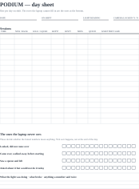
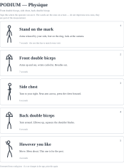
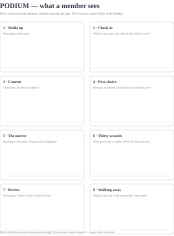
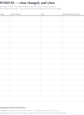

# PODIUM — the paper that lives in the room

**Five sheets to print. Three of them you write on every day.**

16 October 2026

---

The laptop records everything that happens. These exist for everything that
doesn't — the person who looked and kept walking, the morning the light
changed, the cue you reworded without writing it down. None of it can be
collected by software, and all of it decides whether the numbers that *are*
collected mean anything.

| Sheet | Print | For |
|---|---|---|
| **Day sheet** | one per shift | Sessions as they happen, and the people who didn't have one |
| **Pose card** | one, taped up | The exact words the app says, so you don't improvise new ones |
| **Storyboard** | one | Half an hour, now, before the pilot starts |
| **Change log** | one, in the folder | The rule in `DECISIONS.md` that has had nowhere to be written |
| **Keep / cut** | one, at the end | What survives the pilot |

[newpage]

## The day sheet

The top half is the running record. The bottom half is the part that matters
and the part everyone forgets.

**Tick as it happens, not at the end of the day.** At six o'clock you will
remember three walk-aways out of eleven, and the three you remember will be
the interesting ones, which is the worst possible sample.

Why it earns a line on paper when the laptop already counts sessions: the
funnel on the operator screen can only count people who touched it. A return
rate of 30% out of people who came over is a different number from 30% of
people who saw it — and the gap between those two is the entire question of
whether this works on a gym floor or only in a demo.



[newpage]

## The pose card

Generated from `config.json`, so the words on the wall are the words on the
screen. If a cue gets reworded in the app, print this again — and write the
change on the change log, because a reworded cue changes what members do,
which changes what the photographs show.

Tape it where the operator stands, not where the member stands. The member
gets the screen; the operator gets the card.



[newpage]

## The storyboard

Half an hour, with the laptop shut.

Eight boxes, one per screen. Draw what a member sees in each, from memory. The
box you cannot fill in is the finding — it is the screen you have stopped
looking at, and it is usually where people are leaving.

Then guess which box loses the most people, write the guess in the margin, and
only then open the operator console and look. If your guess is wrong, that is
worth more than the number is.



[newpage]

## The change log

`DECISIONS.md` has said this for weeks:

> One change at a time. If you change the light, the price, the script or the
> poses mid-pilot, the metric it affects restarts from that date and you say
> so in the log.

There has never been a log. That is how a rule quietly becomes a sentence
nobody follows — not by being broken, but by having nowhere to live.

Keep this in the folder with the day sheets. Four weeks from now it is the
difference between "keep rate was 61%" and "keep rate was 61%, and here is
every reason that number might not mean what it looks like".



[newpage]

## Keep / cut

You said it yourself: add everything, delete what we don't want at the end.
This is the end-of-pilot sheet for doing that honestly, and it is worth
reading once now so you know what you are judging.

Go down the list after the four weeks. For each one: **did a member ever
benefit from this, and would you build it again?** Tick one box. Don't argue
with yourself on paper — the arguing happens afterwards.

```
MEMBER-FACING                                     KEEP   CUT   ?
  The alignment mirror (ghost + lock ring)        [  ]  [  ]  [  ]
  Pose choice — Physique or Athlete               [  ]  [  ]  [  ]
  The 5-second pre-roll                           [  ]  [  ]  [  ]
  Silhouettes during capture                      [  ]  [  ]  [  ]
  The candid frame                                [  ]  [  ]  [  ]
  Send / keep as two separate toggles             [  ]  [  ]  [  ]
  Side-by-side compare                            [  ]  [  ]  [  ]
  Slide-across compare                            [  ]  [  ]  [  ]
  Flip compare                                    [  ]  [  ]  [  ]
  The visit timeline                              [  ]  [  ]  [  ]
  The progress card                               [  ]  [  ]  [  ]
  "Come back in 4 weeks?" at the end              [  ]  [  ]  [  ]
  Delete everything about me                      [  ]  [  ]  [  ]

UNDER THE BONNET
  Registering photos onto the first visit         [  ]  [  ]  [  ]
  Camera lock (exposure / WB / focus)             [  ]  [  ]  [  ]
  Light drift watch                               [  ]  [  ]  [  ]
  Squad mode (2–3 people)                         [  ]  [  ]  [  ]
  Code identity mode (no phone number)            [  ]  [  ]  [  ]

OPERATOR
  Readiness checks                                [  ]  [  ]  [  ]
  Sealed dashboard until the end                  [  ]  [  ]  [  ]
  Queue counter                                   [  ]  [  ]  [  ]
  The generated write-up                          [  ]  [  ]  [  ]
  CSV export                                      [  ]  [  ]  [  ]
```

**Three questions to answer underneath, in writing:**

1. Which of these did a member ever mention, unprompted?
2. Which did you, as the operator, actually use on a busy evening?
3. Which one would you miss if it vanished overnight?

Anything that is a no to all three is a cut, however much work it was. That is
the whole point of writing it down before you are attached to the answer.

---

*All five sheets are generated — `node tools/make-sheets.mjs` and
`node tools/make-cards.mjs` — so they cannot drift from the app. Print them
again whenever the app changes.*
